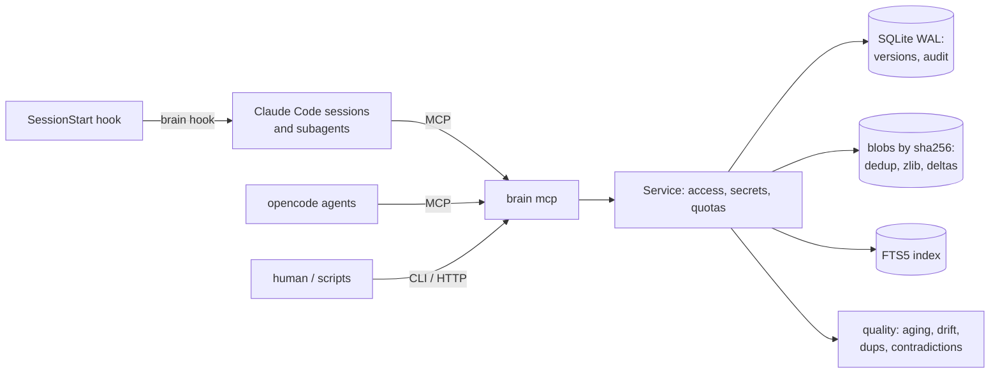

# artek-brain

[](https://github.com/itsuppartem/artek-brain/actions/workflows/tests.yml)

Shared, versioned memory for people and AI coding agents. One instance per project.

Agents (Claude Code, opencode, Cursor) lose context between sessions and overwrite each other's notes. artek-brain gives them one place to read and write project knowledge through MCP, CLI or HTTP, with every change versioned, attributed and reversible. There are no LLM calls inside the memory layer: reads and writes are deterministic.

[Русская версия](README.ru.md) · [Specification (RU)](docs/TZ.md)

## What it does

- **Versioned documents.** Markdown with frontmatter. Every write is a new version with author, reason, sha256 and diff. Roll back a document, a version, one author's edits over a period, or a bad batch.
- **Explicit conflicts.** Writes carry `base_version`; on mismatch the write is refused with the current version and diff. Edits to different sections merge, edits to the same section conflict.
- **Access control.** Read, write and admin rights by path prefix; scoped agent tokens with TTL and revocation. Agents cannot change `rules/`, `owner/` or approved documents; they leave proposals in `owner/inbox` for a human to approve.
- **Secret scanning.** Writes containing keys, tokens or PEM blocks are rejected; secrets are stripped from logs.
- **Search and navigation.** SQLite FTS5 (BM25) with filters, outlines with section sizes, reads by section or token budget, links and backlinks, "what changed since my last visit".
- **Audit and metrics.** Every action is logged, searches included: who, what, when, why, from which session and client (Claude Code, opencode, HTTP).
- **Cheap storage.** Metadata in SQLite (WAL), content in hash-addressed blobs with dedup and compression, quotas, garbage collection, backups with sha256 manifests.

- **Knowledge aging.** Every document has a freshness deadline: explicit `review_by` in frontmatter, or a TTL per folder from `settings.json` (`backlog.md` 7 days, `docs/` 30, `notes/` 90 by default). The brief and `brain quality report` flag overdue documents and "docs behind notes": reference docs that were not updated while new notes piled up after them.
- **Agent brief and hook.** `brain_op(action="brief")` returns a short (≤3000 chars) start-of-work digest: anchors, what to double-check before relying on it, recent changes, inbox. `brain setup` installs a Claude Code `SessionStart` hook, so the brief is injected on start and again after context compaction.

## How it fits together



## Lessons from real use

The memory has been the working memory of a production project (a cash-desk web app plus a Chrome extension, built almost entirely by agents) since November 2026. An audit after the first week of ~40 sessions, 9 parallel worktree sessions and 50+ subagents showed:

- It works where it matters: an owner decision written by one session ("hold changes for the big release") stopped a different session from deploying three hours later; a concurrent edit of the backlog was caught by `base_version` and merged without loss; a secret in a note was rejected and rephrased within seconds.
- What went wrong was not storage but upkeep: reference docs were filled once and never updated, while 50+ notes piled up. A typical fact ("prod is on version X", "server Y") stayed true for 3–5 days. Agents that read memory first got a stale picture.
- Agents read memory only when told to: worktree sessions and subagents ignored it unless the prompt named it; after context compaction the agent recovered from files on disk, not from memory. Multi-word searches returned nothing in half the cases, and two out of three truncated reads were never continued.

Version 0.2 addresses exactly these: TTL-based aging, the "docs behind notes" detector, a brief with a "check before relying" block, a compaction hook, any-word search fallback, line-based truncation with the list of unread sections, and per-session/client attribution in the audit log.

## Quick start

```bash
uv tool install --from git+https://github.com/itsuppartem/artek-brain "artek-brain[mcp]"
cd /path/to/project && brain setup --name "My project"
```

`brain setup` creates `.brain/` (database plus `owner.token` and `agent.token`, mode 600, git-ignored), `.mcp.json` for Claude Code, `opencode.json` for opencode agents (each tagged with its own `BRAIN_CLIENT` for the audit log), a rules block in `AGENTS.md` and a `SessionStart` hook in `.claude/settings.json` (skipped if the hook is already in your user-level `~/.claude/settings.json`, which also covers git worktrees). Re-running it is safe and upgrades the rules block in place. Other commands never create an empty store silently. The MCP server looks for `.brain` up the directory tree, so agent worktrees inside the project share the same memory.

## Performance

`uv run python scripts/bench.py 1000` on a laptop (12 threads, SQLite on SSD), 1000 notes of ~1.7 KB:

| operation | median | p95 |
|---|---|---|
| write (new version, secret scan, audit) | 6.0 ms | 10.4 ms |
| read | 0.2 ms | 0.3 ms |
| search (FTS5 + filters + audit) | 170 ms | 189 ms |

On disk: 15.6 MB including indexes and WAL.

## Tests

```bash
uv run pytest -q                              # 183 tests
BRAIN_SANDBOX_TESTS=1 uv run pytest -q        # plus sandbox tests (use systemd-run)
uv run pytest -m load                          # load tests
```

## How it was built

Designed and specified by me; most of the code was written by AI coding agents (opencode and Claude Code) working from the spec in `docs/TZ.md`, with review and tests before merge. It is used day to day as the memory layer for my own agent-driven projects.

## Status

Early (0.2.0), single-tenant, self-hosted. Python 3.12+, stdlib plus minimal dependencies (`mcp` is optional).

## License

MIT
