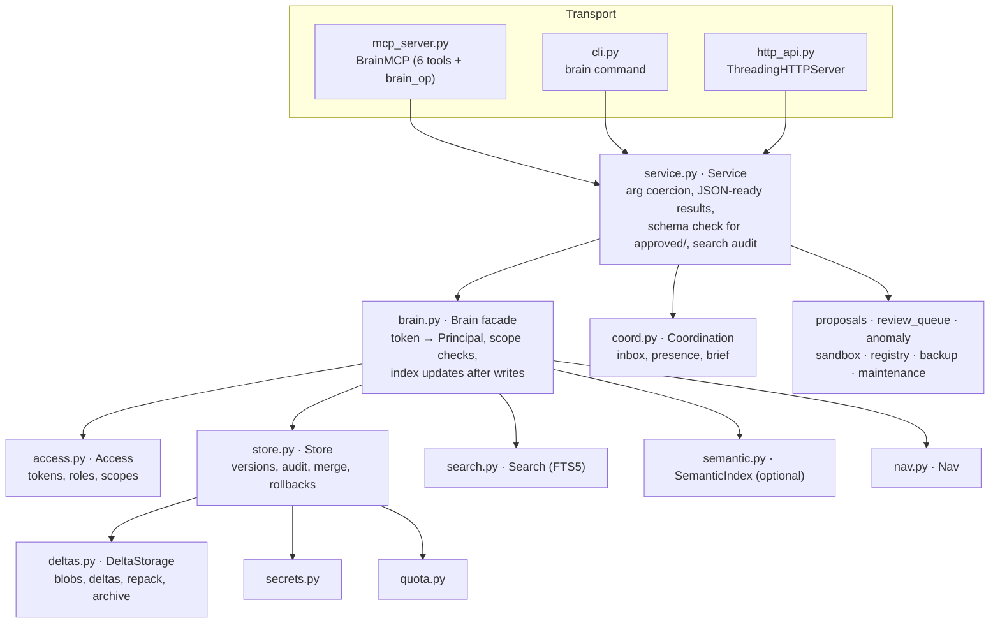
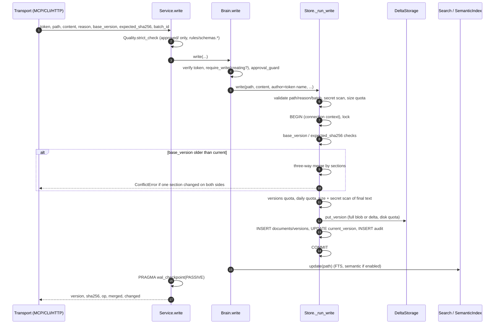

# Architecture

This document describes how artek-brain is built, as of version 0.2.1. Every statement here points at code in `src/artek_brain/`; file and function names are given so you can check them.

- [Layers](#layers)
- [Modules](#modules)
- [Files on disk](#files-on-disk)
- [Data model](#data-model)
- [Write path](#write-path)
- [Section merge and conflicts](#section-merge-and-conflicts)
- [Read path](#read-path)
- [Search](#search)
- [Access control](#access-control)
- [Knowledge quality and aging](#knowledge-quality-and-aging)
- [Coordination: inbox, presence, brief](#coordination-inbox-presence-brief)
- [Sandbox](#sandbox)
- [Backups and maintenance](#backups-and-maintenance)
- [Schema versioning](#schema-versioning)
- [Concurrency model](#concurrency-model)

## Layers



There are three transports and they share one code path:

1. **Transport** (`mcp_server.py`, `cli.py`, `http_api.py`) parses input and formats output. It holds no business rules. The MCP layer adds response-size limits; the HTTP layer maps error classes to status codes (`_error_status`: 401/403 for `PermissionDenied`, 404 not found, 409 conflict or quota, 410 deleted, 400 validation and secrets).
2. **Service** (`service.py`) is the API the transports call. Every method takes the caller's token first and returns JSON-serialisable data. It turns strings into ints (`_as_int`), comma lists into lists (`_as_list`), runs the schema check for `approved/` before a write (`Quality.strict_check`) and records successful searches in the audit log.
3. **Brain facade** (`brain.py`) verifies the token on every call, checks scopes for the target path, logs denials to the audit log and, after any change, updates the FTS index and the optional semantic index. The author of a version is always the token's name, never a parameter.
4. **Core**: `Store` (SQLite + blobs), `Access` (tokens), `Search`, `SemanticIndex`, `Nav`, and helper modules. The core has no network access and makes no LLM calls; the only outbound call in the package is `OllamaEmbedder`, which talks to a local Ollama server when semantic search is configured to use it.

`Service.__init__` wires everything together: `Store`, `Access.for_store`, `Brain`, `ReviewQueue`, `Coordination`, `ProposalStore` (installed as `Brain.approval_guard`), `AnomalyDetector`, `Sandbox` and `Registry` (with `sandbox.run` as its one registered tool).

## Modules

All 30 files in `src/artek_brain/` (about 18.8k lines including docstrings).

| Module | Role |
|---|---|
| `__init__.py` | Public Python API: re-exports `Store`, `Brain`, `Access`, `Search`, errors and result types. |
| `__main__.py` | `python -m artek_brain` entry point, calls `cli.main`. Used by `brain setup` when `brain` is not on `PATH`. |
| `cli.py` | `brain` command (argparse). Token from `--token`, `BRAIN_TOKEN`, or `.brain/agent.token`. Text or `--json` output. Also `brain hook session-start`. |
| `mcp_server.py` | MCP stdio server: six tools, `brain_op` multiplexer, `brain_help`, response limit with `_fit_read` and `_limit`. Falls back to a minimal JSON-RPC loop when the `mcp` package is missing (`_run_fallback`). |
| `http_api.py` | JSON API on stdlib `http.server` (`ThreadingHTTPServer`), Bearer auth, body size limit, `/openapi.json`, `/rpc`. Binds `127.0.0.1:8765` by default. |
| `service.py` | Shared operation layer for all transports; also `resolve_root()` (finding `.brain`). |
| `brain.py` | Permission-checking facade over `Store`, `Search`, `SemanticIndex` and `Nav`. Agent rollback restrictions live here. |
| `store.py` | Core storage: `documents`/`versions`/`audit` schema, write with `base_version`, three-way section merge, read by section/lines, soft delete, restore, rollbacks, export/import, stats, gc, `PRAGMA user_version`. |
| `deltas.py` | Blob container format, line deltas, snapshot policy, `repack`, `archive_old_versions` (lzma), `disk_report`, disk quota. |
| `access.py` | Tokens (only sha256 stored), roles, scopes, TTL, revoke, suspend; protected paths, `owner/inbox` rule, Unicode look-alike normalisation for path policy. |
| `secrets.py` | Regex secret scanner (`scan`, `assert_clean`), `redact` and `sanitize_json` for audit details. |
| `quota.py` | `Quota` dataclass: document size, versions per document, writes per author per UTC day, optional total disk limit. |
| `errors.py` | Error hierarchy; every error carries `message` and `hint` ("what is wrong / what to pass"). Messages are in Russian. |
| `frontmatter.py` | Minimal YAML-like frontmatter parser and writer (scalars and `[a, b]` lists), no dependencies. |
| `search.py` | FTS5/BM25 index in `search.sqlite3` over current versions and full history; filters; incremental catch-up by fingerprint; `match=any` fallback. |
| `semantic.py` | Optional semantic index in `semantic.sqlite3` (chunks + float32 vectors, brute-force cosine), settings in `settings.json`, `hybrid_search` with RRF. |
| `embeddings.py` | `HashEmbedder` (deterministic hashing trick over words and character trigrams) and `OllamaEmbedder` (`POST /api/embed` via `urllib`). |
| `nav.py` | `ls`/`tree` with sizes and version counts, table of contents, links, backlinks, broken links, change feed by audit id, README map. |
| `coord.py` | `Coordination`: inbox messages, agent presence, `who_knows(path)`, the brief. Migrates tables from the removed task board. |
| `project.py` | `brain setup`: creates `.brain/`, tokens, `.mcp.json`, `opencode.json`, `AGENTS.md` block, `CLAUDE.md` import, `SessionStart` hook. |
| `aging.py` | Freshness by TTL per folder/file (`settings.json` → `aging`), "docs behind notes" detector, brief anchor paths. |
| `quality.py` | Duplicates (Jaccard over word 5-shingles), contradictions (`facts` and numeric table cells), broken links, type schemas from `rules/schemas.json`/`.md`, quality report. |
| `knowledge.py` | Helpers shared by quality checks: document snapshot via the facade, shingles, Jaccard, date parsing. |
| `drift.py` | `refs` in frontmatter (`path@sha256` or `path#symbol@git-sha`), drift check against a repository, `mark_stale`, `pin`. |
| `review_queue.py` | Review queue table (`drift`, `status_review`, `overdue_review`, `evidence_mismatch`); approve/reject/defer for owner and human only. |
| `proposals.py` | Proposals in `proposals/<agent>/…`, approval into protected areas by owner/human (not the author), guard against silent edits of `approved/`. |
| `anomaly.py` | Deterministic detectors over audit and versions (version spikes, mass edits, repeated rollbacks, protected-path probing, hidden reads, size growth); incidents go to `owner/inbox/incidents`, optional auto-suspend. |
| `sandbox.py` | Script sandbox: bubblewrap + transient systemd scope + prlimit, read-only data slice, network off. |
| `registry.py` | Tool registry (`registry.sqlite3`): JSON schema, minimum role, daily call limit, call log, separate secrets table. |
| `backup.py` | `tar.gz` backups via `sqlite3.Connection.backup`, sha256 manifest, rotation, verification. |
| `maintenance.py` | `wal_checkpoint(TRUNCATE)` on every `*.sqlite3`, then repack, gc (so blobs freed by repack go in the same run), disk report. |

## Files on disk

A store is one directory, by default `<project>/.brain/`:

| Path | Content |
|---|---|
| `brain.sqlite3` | Documents, versions, audit, delta metadata, inbox, presence, proposals, review queue, anomaly incidents. Mode 600 (as are `search.sqlite3`, `access.sqlite3` and `semantic.sqlite3`; `blobs/` is mode 700). |
| `blobs/aa/bbbb…` | Content blobs, file name = sha256 (first two hex chars are the folder). |
| `access.sqlite3` | Tokens (sha256 of the token, never the token itself). Created with the default umask, like the other databases below. |
| `search.sqlite3` | FTS5 index (derived, can be rebuilt). Holds the full text of documents. |
| `semantic.sqlite3` | Semantic chunks and vectors (derived, only when enabled). |
| `registry.sqlite3` | Tool registry, call log, tool secrets. |
| `settings.json` | Optional settings (`semantic`, `aging`, `brief`). See [configuration.md](configuration.md). |
| `owner.token`, `agent.token` | Tokens written by `brain setup`, mode 600. |
| `legacy/*.json` | Rows of task-board tables dropped on upgrade (only for stores created before 12.11.2026). |
| `sandbox/` | Sandbox job state, so another process can query `status`/`cancel`. |

## Data model

The core schema is `_SCHEMA` in `store.py`:

```sql
CREATE TABLE documents (
    path TEXT PRIMARY KEY,
    current_version INTEGER,
    deleted INTEGER NOT NULL DEFAULT 0,      -- soft delete
    created_at TEXT NOT NULL
);
CREATE TABLE versions (
    id INTEGER PRIMARY KEY AUTOINCREMENT,
    path TEXT NOT NULL, n INTEGER NOT NULL, parent_n INTEGER,
    sha256 TEXT NOT NULL, size INTEGER NOT NULL,   -- of the full content
    author TEXT NOT NULL, reason TEXT, ts TEXT NOT NULL,
    batch_id TEXT,
    op TEXT NOT NULL,          -- create | write | merge | delete | restore |
                               -- rollback | rollback_author | rollback_batch
    UNIQUE(path, n),
    FOREIGN KEY (path) REFERENCES documents(path) ON DELETE CASCADE
);
CREATE TABLE audit (
    id INTEGER PRIMARY KEY AUTOINCREMENT,
    ts TEXT NOT NULL, actor TEXT, action TEXT NOT NULL, path TEXT,
    detail_json TEXT,          -- secrets redacted by secrets.sanitize_json
    session TEXT, model TEXT
);
```

Indexes: `versions(path, n)`, `versions(author, ts)`, `versions(batch_id)`, `audit(ts)`, `audit(actor)`, `audit(action)`.

- A **document** is a logical path such as `docs/deploy.md`. Paths are normalised (NFKC, no leading `/`, no `\`, no `.`/`..`/empty segments, no control characters, at most 1024 chars; `Store._normalize_path`).
- A **version** is immutable metadata plus the sha256 of the full UTF-8 content. `reason` is required (1–2000 chars) and passes through `secrets.redact` before it is stored.
- The **audit log** records every read, write, search, denial and admin action, with `ok: true/false` in `detail_json`, plus `session` and `model` (the MCP server fills these from `BRAIN_SESSION`, `BRAIN_MODEL`, `BRAIN_CLIENT` and the client's `clientInfo`).
- Timestamps are ISO 8601 UTC with microseconds.

### Blobs and deltas

`deltas.py` owns the physical layout. Metadata lives in `version_blobs`:

```sql
CREATE TABLE version_blobs (
    path TEXT NOT NULL, n INTEGER NOT NULL,
    kind TEXT NOT NULL,             -- full | delta
    content_sha256 TEXT NOT NULL,   -- sha256 of the full text of this version
    blob_sha256 TEXT NOT NULL,      -- file name in blobs/
    base_n INTEGER,                 -- delta base (previous version)
    depth INTEGER NOT NULL,         -- 1 for a full blob, base depth + 1 for a delta
    archived INTEGER NOT NULL DEFAULT 0,
    stored_bytes INTEGER NOT NULL,
    codec TEXT NOT NULL,
    PRIMARY KEY (path, n)
);
```

- **Container format.** Every blob file is `ABLOB1` + one codec byte (`0` zlib level 6, `1` lzma preset 9) + compressed payload (`encode_container`). Files without the magic prefix are read as raw zlib, so stores written before deltas existed need no migration.
- **Delta format.** `BRAIN-DELTA-1\n` + JSON of `difflib.SequenceMatcher` line opcodes against the previous version (`encode_delta`). Deterministic, line-based.
- **When a delta is stored** (`DeltaStorage.put_version`): the version is stored as a full blob if it is the first version, if `(n - 1) % snapshot_every == 0` (default `snapshot_every = 20`), if the parent's chain depth already reached `snapshot_every`, or if the compressed delta is not smaller than `delta_ratio` (default 0.9) of the compressed full copy. Otherwise it is a delta to `n - 1`. Chains are therefore at most 20 deep.
- **Dedup.** If a full blob with the same content sha256 already exists, it is reused and no new file is written.
- **Reading** (`read_content`): a full blob is decompressed directly; otherwise the chain is rebuilt from the nearest full snapshot and the result is checked against the expected sha256.
- **Repack** (`store.repack`, `brain repack`): rewrites existing versions into the delta layout in one transaction, verifies sha256 after every version, and is idempotent.
- **Archive** (`store.archive_old_versions(older_than, keep_last)`, Python API only): recompresses cold versions with lzma and marks them `archived`.
- **GC** (`store.gc`): deletes every file under `blobs/` that is not referenced by a `versions` row without delta metadata or by `version_blobs.blob_sha256` and is older than one hour (`GC_GRACE_SECONDS`). The grace period protects a blob that another process has written but not yet committed.

The load test in `notes/BRAIN-5.md` (500 documents, 20,000 versions of ~25 KB, one process) measured 13.4 MB of blobs against 499 MB of logical full copies, and 35 MB on disk in total, including SQLite.

## Write path



Step by step, with the function that does it:

1. **Schema check** — `Service.write` calls `Quality.strict_check(token, path, content)`. It only applies to paths under `approved/` and only when `rules/schemas.json` or `rules/schemas.md` exists; missing required frontmatter fields reject the write with `ValidationError`.
2. **Token and scope** — `Brain.write` normalises the path, checks whether the document exists, then `Access.require_write(principal, path, creating=...)`. Rules are in [Access control](#access-control). A denial is written to the audit log (`Brain._deny`) and raised as `PermissionDenied`.
3. **Approval guard** — `ProposalStore.guard_write`: agents cannot write under `approved/` at all; for anyone else, an *existing* `approved/` document can only be replaced by content whose sha256 matches a recorded approval.
4. **Validation and secret scan** — `Store._run_write` validates path, author (from the token), reason and `batch_id`, then `secrets.assert_clean(content)`. A hit raises `SecretDetectedError` with the secret type and line number, never the secret itself.
5. **Size quota** — `Quota.check_document_size` (1 MiB by default).
6. **Transaction** — everything below runs under the store's `threading.RLock` and inside `with self._conn:` (one SQLite transaction, committed on success, rolled back on any error).
7. **Version checks** (`Store._write_locked`):
   - new document: `base_version` and `expected_sha256` must be absent (`create`);
   - deleted document: `DeletedError`, call `restore` first;
   - existing document without `base_version`: `BaseVersionRequiredError` with the current version in the hint;
   - `base_version` outside `1..current`: `InvalidVersionError`;
   - `expected_sha256` given and not equal to the current sha256: `ConflictError` immediately, no merge attempted;
   - content identical to the current version: `op = "noop"`, no new version.
8. **Merge or conflict** — if `base_version == current`, or the base version has the same sha256 as the current one, the content is written as is (`op = "write"`). Otherwise `_merge_three_way(base, current, new)` runs; see the next section. A clean merge produces `op = "merge"`, `merged = true`.
9. **Remaining quotas** — versions per document and writes per author per UTC day; then size and secret scan again on the *final* (possibly merged) text.
10. **Blob** — `DeltaStorage.put_version` writes the blob file (full or delta) and its `version_blobs` row, checking `max_disk_bytes` if set. Blob files are written with a temp file and `os.replace`; if the transaction later rolls back, the orphan file is removed by a `gc` that runs at least an hour later.
11. **Metadata and audit** — insert into `documents` (for a new path) and `versions`, update `documents.current_version`, insert the audit row with version, op, sha256, size, merged, batch and reason. Then commit.
12. **Failure audit** — on any `ArtekBrainError` the failure is logged in a separate short transaction (`_log_failure`, `ok: false`).
13. **Indexes** — after commit, `Brain.write` calls `Search.update(path)` and, if semantic search is on, `SemanticIndex.update(path)`. These run outside the store transaction; if they fail, the next search catches up via the fingerprint check (see [Search](#search)).
14. **Checkpoint** — `Service.write` ends with `PRAGMA wal_checkpoint(PASSIVE)` so the WAL does not grow while long-lived MCP processes hold the database open.

`delete`, `restore` and `rollback_*` follow the same pattern: permission check in `Brain`, one transaction in `Store` that adds a new version (`op` is `delete`, `restore`, `rollback`, `rollback_author` or `rollback_batch`) and an audit row, then an index update. History is never rewritten by these operations.

> **Exception: `overwrite`.** `Store.overwrite_current` (exposed as `Service.overwrite` and `POST /overwrite`, owner only) replaces the content of the *current* version in place: no new version, but an `overwrite` audit row records the old and new sha256. It exists for owner hot fixes. It still runs the secret scan, size quota and approval guard. Agents and humans cannot call it.

## Section merge and conflicts

The merge is implemented in `store.py` by `_split_sections` and `_merge_three_way`.

**Splitting.** A Markdown document is split at ATX headings (`#` to `######`). Headings inside fenced code blocks (```` ``` ```` or `~~~`) are ignored. Text before the first heading is the `__preamble__` section. Each section's key is `level:title:occurrence`, so two `## Notes` headings at the same level are different sections, and a heading's text and level are part of its identity.

**Merging.** For every section key that appears in the new text, the current text or the base text (in that order, which also defines the output order), the merge compares three values: base, current and new. A missing section counts as a value (`None`), so deleting a section is a change.

| base → current | base → new | Result |
|---|---|---|
| unchanged | unchanged | keep |
| changed | unchanged | take current |
| unchanged | changed | take new |
| changed | changed, same result | take it once |
| changed | changed, different | **conflict** for this section |

If any section conflicts, nothing is written. `ConflictError` carries the path, the current version, the list of conflicting section titles and a unified diff between the current text and the submitted text. The CLI, HTTP and MCP layers return the message and hint (current version, section titles); the diff stays on the exception object and is not included in their responses.

Consequences worth knowing:

- Two agents editing different sections from the same `base_version` both succeed; the second one gets `op: "merge"`.
- Two agents editing the same section conflict even if their edits touch different lines.
- Renaming a heading is a delete of one section plus an add of another; if the other side edited the old section, that is a conflict.
- `expected_sha256` is a stricter check: any change since the given hash is a conflict, regardless of sections.

What to do on a conflict is in [usage.md](usage.md#agent-workflow).

## Read path

`Store.read(path, version, section, line_range, max_chars)`:

1. Loads the requested version (current by default). Deleted documents raise `DeletedError`.
2. `section` selects one heading and everything under it until the next heading of the same or higher level (`_select_section`). Matching is exact first, then case-insensitive; `"preamble"` selects text before the first heading. An unknown section lists the available headings in the error.
3. `line_range` (1-based, inclusive) is applied to the selected text.
4. `max_chars` cuts the result and sets `truncated: true`.
5. The read is audited (version, section, range, chars, truncated) in the same transaction.

The result carries `path`, `version`, `content`, `truncated`, `total_chars`, `total_lines`, `section`, `line_range`.

### Response limits in MCP

The MCP server limits every tool response to `--max-chars` characters (default 8000, minimum 200).

- **Reads** go through `BrainMCP._fit_read`. If the JSON for a read is longer than the limit, the content is cut at a line boundary (budget: limit minus 1800 characters for metadata), and the response gets `truncated: true`, `shown_lines` such as `"1-6"`, `total_lines`, `next: {path, line_start}` and `remaining_sections` — the headings that were not shown, each with its line number. The agent can continue with `brain_read(path, line_start=…)` or `brain_read(path, section=…)`. This replaced cursor-based truncation for reads in 0.2.0 after an audit found that two of three truncated reads were never continued.
- **Everything else** goes through `BrainMCP._limit`: the serialised JSON text is cut into a chunk and returned as `{"truncated": true, "cursor": "<offset>", "total_chars": N, "chunk": "…"}`. Calling the same tool again with `cursor` returns the next chunk. The chunk is a slice of the JSON string, so a client has to concatenate all chunks before parsing.

## Search

### Full-text (FTS5)

`search.py` keeps a separate database `search.sqlite3` with two FTS5 tables (`tokenize='unicode61'`):

- `current_fts` — one row per live document: `title` (first heading) and `body` are indexed; `path`, `doc_type`, `status`, `tags`, `author`, `ts`, `version` are stored, not indexed.
- `history_fts` — one row per version, for `history=true` searches.

`type`, `status` and `tags` come from the document's frontmatter.

**Query.** `_fts_query` quotes every whitespace-separated term and joins them with `AND` (`match: "all"`). Results are ordered by `bm25(current_fts)` and get a `snippet()` with matches in `[brackets]`.

**Fallback.** If the strict query returns nothing readable, the search runs once more with `match: "any"`: each term is reduced by `_stem` (terms longer than 5 characters lose their last two characters, keeping at least four) and used as a prefix query (`"term"*`), joined with `OR`. The response then has `"match": "any"` and a `note`. This was added in 0.2.0 after multi-word searches returned nothing in about half the cases in production use. The stemming is crude truncation, not morphology.

**Filters.** `path_prefix`, `type`, `status`, `tags` (each tag must be present), `author`, `since`, `until` are SQL conditions on the stored columns. Read permission is applied in Python (`can_read`) to every candidate before pagination, so other people's documents never leak into results or counts. `limit` is 1–1000, `offset ≥ 0`.

**Incremental sync.** The index is updated by the facade after every change. To also catch writes made by another process or directly through `Store`, `Search._signature()` computes a fingerprint of the store (`COUNT`, `MAX(id)`, `SUM(n)` of versions; `COUNT`, `SUM(current_version)`, `SUM(deleted)`, `SUM(LENGTH(path))` of documents). Before every search, if the fingerprint differs from the last one seen, `sync()` compares `documents` with `indexed_docs` and re-indexes only the paths whose version or deleted flag changed, plus their new history rows. The fingerprint is stored in `meta`, so reopening an unchanged store does not touch the index. A full `rebuild()` happens only for an empty, outdated (`schema` in `meta` other than `"2"`) or corrupt index; a corrupt file is recreated.

**Audit.** `Service.search` writes one audit row per successful search (`action: search` or `search_history`) with the query (first 200 chars), mode, number of hits and match mode, so it is visible what agents search for and do not find.

**Cost.** The SQL query has no `LIMIT`; all matches are fetched, filtered by permission and then paginated. Together with the fingerprint query and the audit write, this is why a search takes about 170 ms median on 1000 notes (`scripts/bench.py`, README), against 0.2 ms for a read.

### Semantic and hybrid (optional)

Off by default. When `settings.json` has `"semantic": {"enabled": true, ...}`, `SemanticIndex.from_store` opens `semantic.sqlite3`:

- Documents are chunked by Markdown section with a 1500-character window (`CHUNK_CHARS`); vectors are stored as float32 BLOBs together with the document's version, type, status, tags, author and time.
- Embedders: `hash` (`HashEmbedder`, deterministic, no model, no network: words plus character trigrams hashed with blake2b into `dim` buckets with ±1 signs, L2-normalised) or `ollama` (`OllamaEmbedder`, local HTTP API).
- Similarity is brute-force cosine in Python. Above 50,000 chunks (`PREFILTER_THRESHOLD`) candidates are first restricted to FTS hits.
- Changing the embedder or dimension marks the index stale; `brain semantic reindex` rebuilds it.

`mode=hybrid` (`semantic.hybrid_search`) runs FTS and semantic search with the same filters and permission check, each to a depth of `max(limit + offset, 100)` (at most 1000), and merges them with Reciprocal Rank Fusion: `score = Σ 1 / (60 + rank)`. If semantic search is disabled, `Service.search` runs `hybrid` as `fts` and adds a `warning`; `mode=semantic` raises an error with a hint. History search is FTS only.

## Access control

`access.py`, enforced in `brain.py`.

**Tokens.** `Access.create_token(name, role, scopes, ttl)` returns a random token (`ab_` + `secrets.token_urlsafe(32)`) once; only its sha256 is stored in `access.sqlite3`. A token can have an expiry (`ttl` in seconds → `expires_at`), can be revoked (`revoked_at`) or suspended and resumed (`suspended_at`). `Access.verify` rejects unknown, revoked, suspended and expired tokens with `PermissionDenied`.

**Roles** (`ROLES`):

| Role | Reads | Writes | Audit and stats |
|---|---|---|---|
| `owner` | everything | everything, including protected paths; `overwrite`; token management | yes |
| `human` | by scopes | by scopes, not protected paths; can approve proposals and review-queue items | no |
| `agent` | by scopes | by scopes, not protected paths; rollbacks only of its own edits | no |
| `auditor` | no documents | nothing | yes (`audit`, `stats`, anomaly list) |

**Scopes.** A scope is `prefix:level` with level `read < write < admin`, e.g. `docs:write`. `""` (empty prefix) or `*` covers the whole store; `brain setup` gives the agent token `:write`. A path is covered if it equals the prefix or starts with `prefix/`. Higher levels imply lower ones. Search, `ls`, `tree`, backlinks and the change feed filter out every path the token cannot read.

**Protected paths** (`is_protected`): first segment `owner`, `rules`, `approved`, `scoring` or `hidden`, and the root `README` / `README.md`. Only `owner` writes there. Before matching, the path is normalised with NFKC, case folding and a table of look-alike characters (Cyrillic/Greek letters, digits such as `0`→`o`), so `Rules/`, `ruIes/` or `rulеs/` with a Cyrillic `е` are still protected.

**Hidden.** `hidden/` is unreadable for everyone except `owner`. Reads of hidden paths are one of the anomaly signals.

**Inbox.** `owner/inbox/<file>` (exactly one segment after `inbox/`) is the exception: any token with at least one write scope may *create* a new file there, but not edit an existing one. This is how agents leave proposals for a human.

**Agent rollbacks.** An agent may roll back a document only if every version after the target was written by itself (`Brain.rollback_version`), may run `rollback_author` only for its own name, and `rollback_batch` only for batches that contain only its own versions.

**Proposals.** `ProposalStore` (`proposals.py`) keeps agent proposals under `proposals/<agent>/…` and lets owner or human approve one into a protected path; the author cannot approve their own proposal, and each approval stores the sha256 of the approved content. Through the plain write API, `proposals/` is not a protected folder.

## Knowledge quality and aging

All checks are deterministic and read documents through the facade with the caller's token.

- **Aging** (`aging.py`). `freshness(store)` computes, for every live document, the age of its last version, the TTL for its path (longest matching key in `aging.ttl_days`, see [configuration.md](configuration.md#aging)), whether it is overdue, how many `notes/` documents were created after its last change and how many times it was read (from the audit log). It reads only metadata, never content. `lagging_docs` flags non-`notes/` documents with at least 3 newer notes and age ≥ 1 day ("docs behind notes"). The brief and `brain quality report` use both.
- **Quality report** (`Quality.report`): counts, `refs` coverage, `review_by` overdue, TTL overdue for documents without `review_by`, docs behind notes, `stale` documents and the open review-queue size. `fresh_ratio` counts a document as not fresh if any of these signals applies.
- **Duplicates** (`Quality.duplicates`): Jaccard similarity over word 5-shingles, threshold 0.8 by default.
- **Contradictions** (`Quality.contradictions`): (1) `facts: [key=value, …]` in frontmatter of approved documents with different values for the same key; (2) numeric cells in Markdown tables, only when the row key, the column header and the unit match. Numbers with thin-space thousands ("1 271 276") are parsed whole; numbers in the middle of a phrase are ignored.
- **Schemas**: `rules/schemas.json` or `rules/schemas.md` maps a frontmatter `type` to required fields; enforced on write only under `approved/`. See [configuration.md](configuration.md#rulesschemasjson).
- **Drift** (`drift.py`): `refs` in frontmatter bind a document to code, e.g. `src/app.py@<sha256>` or `src/app.py#build@<git-sha>`. `brain quality drift --repo .` recomputes hashes (`git hash-object` for git hashes) and reports changed or missing files; `--mark-stale` sets `status: stale` and opens review-queue items.
- **Review queue** (`review_queue.py`): table `review_queue` in `brain.sqlite3` with reason, `path@version`, status `open | approved | rejected | deferred`. `brain quality drift --mark-stale` adds `drift` items; `brain quality queue sync` adds documents with `status: review` and overdue `review_by`; approve/reject/defer need owner or human.

## Coordination: inbox, presence, brief

`coord.py`, tables `messages` and `agents` in `brain.sqlite3`. The sender of a message and the agent in presence always come from the token.

- **Inbox**: `send(to, subject, body)`, `inbox(unread)`, `mark_read(ids)`.
- **Presence**: `presence(activity)` upserts `agents.last_seen`; `agents_online(ttl_seconds=300)` lists recent ones.
- **who_knows(path)**: the last version's author, number, time and reason for a path or folder.
- **Brief** (`Coordination.brief(agent, limit)`): a deterministic text for the start of a session. It lists the anchor documents (`brief.paths`, default `README.md`, `backlog.md`), documents overdue by TTL with "check before relying" advice (up to 6), docs behind notes (up to 5), agents seen in the last 15 minutes (up to 6), the 8 most recent versions with author and reason, and unread inbox messages (up to 3). It is cut to `limit` characters; the default through MCP, CLI, HTTP and the hook is 2000 (minimum 200).

There is no task board; it was removed on 2026-11-12 (see [design-decisions.md](design-decisions.md#removing-the-task-board)). Opening a store created before that renames `task_messages`/`task_agents` to `messages`/`agents`, drops the other task tables and saves their rows to `.brain/legacy/*.json`.

## Sandbox

`sandbox.py` runs a Python or shell script next to a read-only slice of the memory. It is reached through the tool registry (`Registry.call("sandbox.run", …)`, minimum role `agent`, 100 calls per token per day), `brain sandbox run`, `POST /sandbox/run` and `brain_op(action="sandbox_run")`.

- The slice (`inputs.prefix` / `inputs.paths`, with document and byte limits) is written to a temporary directory, mounted read-only at `/data`, together with a small `brainlib` helper at `/opt/brainlib`. The script can write only to `/out` and a size-limited `/tmp`.
- Isolation: `bwrap --unshare-all --die-with-parent --new-session --cap-drop ALL --clearenv`, root filesystem read-only, network namespace unshared (no network). The process runs in a transient `systemd-run --scope` unit with `TasksMax`, `MemoryMax`, `CPUQuota=100%`, and under `prlimit` for CPU, address space, processes and file size. When run as root, it also switches to uid/gid 65534.
- Limits have defaults and per-role ceilings (agent: 10 s CPU, 20 s wall, 512 MiB, 32 processes, 128 KiB output; human and owner higher). At most 2 concurrent runs, 1 per token.
- If `bwrap` or `systemd-run` is missing, the run is refused with `SandboxUnavailable`; there is no unsandboxed fallback.
- Each run is audited (who, script sha256, slice, exit code, time, sizes) and the script is saved in the store under `runs/sandbox/<id>/`. Results can be cached by script hash + slice + limits.

The sandbox tests need `systemd-run` without a password prompt and are skipped unless `BRAIN_SANDBOX_TESTS=1`.

## Backups and maintenance

- **Backup** (`backup.py`, `brain backup create --output DIR [--keep N]`, owner only): every `*.sqlite3` is copied with `sqlite3.Connection.backup` (consistent while the store is in use), `blobs/` and `settings.json` are copied, everything is packed into `brain-backup-<UTC time>.tar.gz` with a `.manifest.json` of sha256 per file. Mode 600. `--keep` rotates old archives. The `.brain/*.token` files are not included.
- **Verify** (`brain backup verify ARCHIVE`): checks the manifest, unpacks safely to a temp directory, opens the store and verifies the sha256 of every current version. Older versions are not re-read. There is no `restore` command; restoring means unpacking the archive into a `.brain` directory.
- **Maintain** (`maintenance.py`, `brain maintain`, owner only): `PRAGMA wal_checkpoint(TRUNCATE)` on every database (a busy database is reported, not an error), then `gc`, then `repack`, then a disk report; the whole result is audited.
- **Disk report** (`brain disk-report`): database and blob bytes, bytes per version, growth over the last N days and a forecast, quota usage if `max_disk_bytes` is set.

None of these run on a schedule; run them from cron or a systemd timer if needed.

## Schema versioning

`store.py` sets `SCHEMA_VERSION = 1` (the schema without the task board). On open, `Store.__init__` reads `PRAGMA user_version`:

- higher than `SCHEMA_VERSION` → refuses to open with "created by a newer version of artek-brain" and a hint to upgrade, so old code never writes into a newer store;
- lower → runs the idempotent `CREATE TABLE IF NOT EXISTS` schema and sets `user_version`;
- equal → just ensures the schema.

Other modules add their tables with `CREATE TABLE IF NOT EXISTS` and add missing columns in place (e.g. `Access._ensure_columns` for `suspended_at`). Derived indexes carry their own version: `search.sqlite3` stores `schema = "2"` in its `meta` table and rebuilds when it differs.

## Concurrency model

- Each process (one MCP server per agent session, the CLI, the HTTP server) opens its own SQLite connections. All databases use WAL, `busy_timeout = 30000` ms and `synchronous = NORMAL`; `brain.sqlite3` also sets `journal_size_limit` to 1 MB.
- Within a process, `Store` serialises access with a `threading.RLock`; the HTTP server is a `ThreadingHTTPServer` sharing one `Service`.
- Writes are short transactions; conflicts between processes are resolved by `base_version` checks inside the transaction, not by locks held across calls.
- Reads also write (one audit row each), so every read is a small write transaction.
- A bug fixed in 0.2.0 (PR #2): the search audit row was written outside a `with conn:` block, which left a transaction open and made the MCP process hold the write lock after its first search ("database is locked" for everyone else). It is now committed in its own short transaction.
